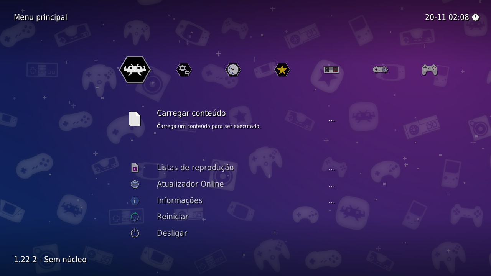
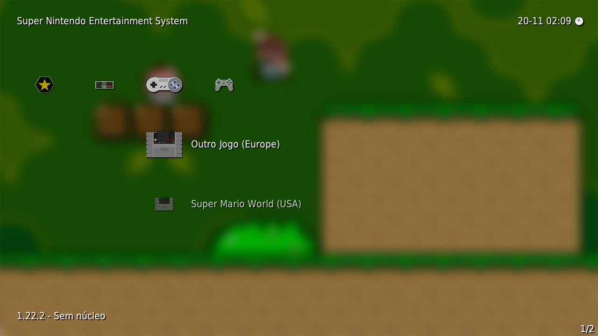
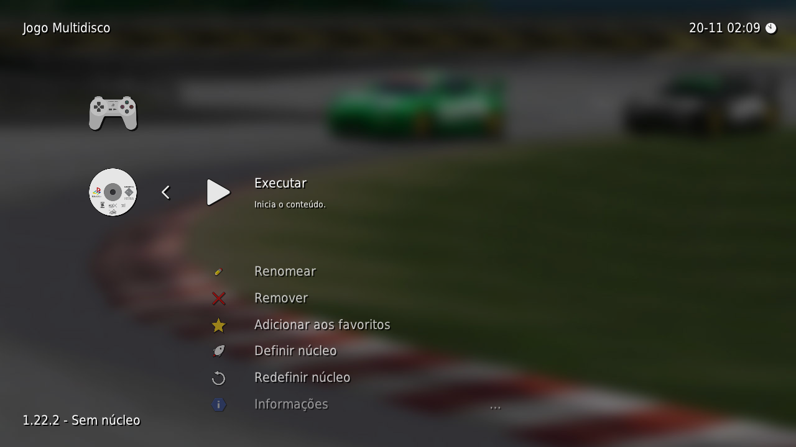
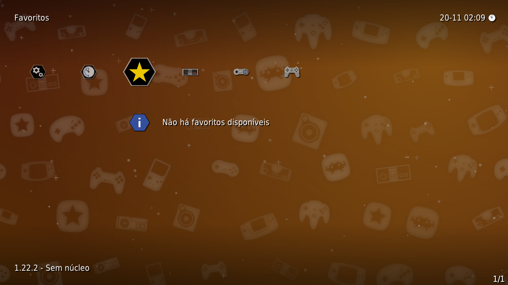

# STV-2000 Retro Linux

**Alpine Linux + RetroArch para o TV Box Aquário STV-2000 (Amlogic S905W).**
Transforma o TV Box antigo em uma estação de jogos retrô leve, que liga direto no
menu de jogos na TV. O sistema roda do cartão microSD, e o **Android original continua
intacto**: sem o cartão, o aparelho liga normalmente no Android.

> [!WARNING]
> **Em desenvolvimento.** A imagem já é gerada e testada em emulador (QEMU), mas
> **ainda não foi validada no aparelho real**. Ela será publicada na aba
> [Releases](../../releases) quando o boot for confirmado no STV-2000.
> Até lá, dá para gerar a imagem você mesmo ([docs/COMPILAR.md](docs/COMPILAR.md)).

## Recursos

- **Leve**: Alpine Linux 3.24 (musl, busybox, OpenRC), kernel mainline 6.18 LTS.
  O RetroArch roda direto na TV (KMS + OpenGL ES 2 na GPU Mali-450 pelo driver aberto
  *lima*), sem X11 nem Wayland.
- **Interface de console, no estilo do Lakka**: liga direto no menu de jogos, em
  português, para usar só com o controle. Cada sistema é uma aba com **ícone colorido**
  (o controle do console) e fundo próprio (tela de um jogo do sistema, desfocada). As
  outras abas têm fundos com tema de jogos. Os jogos aparecem pelo nome, com **capa e tela-título baixadas
  automaticamente** (com cabo de rede), além de **Favoritos**, **Histórico** e tempo
  jogado. Os menus mostram só o necessário.
- **Controles USB configurados sozinhos** (genéricos, Xbox, PlayStation, 8BitDo…).
- **Partição `JOGOS` em FAT32**: coloque o cartão no PC e copie os jogos para a pasta do
  sistema (`roms\snes`, `roms\psx`…). No boot seguinte eles aparecem no menu, cada
  sistema já com o emulador certo.
- **Saves, states, capas e BIOS na mesma partição**, fáceis de fazer backup pelo Windows.
- **Desligar e Reiniciar no menu principal**, como em um console. O aparelho desliga
  com segurança.
- **Wi-Fi interno** (experimental): driver comunitário do chip SSV6051P compilado na
  imagem. É configurado pelo arquivo `JOGOS\wifi.txt`, no Bloco de Notas.
- **Não mexe no Android**: a memória interna (eMMC) não é alterada.
- Acesso por **SSH** e atualizações com `apk upgrade`. O kernel novo é preparado
  automaticamente para o boot Amlogic.

## Como é a interface

```
 [Menu principal] [Configurações] [Histórico] [Favoritos] [Atari - 2600] ... [Nintendo - Super Nintendo] ... [Sony - PlayStation]
                                                                              │
                                                     ← → escolhe o sistema    ├ Chrono Trigger (USA)            ┌─────────┐
                                                     ↑ ↓ escolhe o jogo       ├ Donkey Kong Country (USA)       │  capa   │
                                                     OK  joga                 ├ Super Mario World (USA)  ◄──    │         │
                                                     Start+Select: menu       └ ...                             └─────────┘
```

É o menu XMB do RetroArch, o mesmo do [Lakka](https://www.lakka.tv). Batocera, EmuELEC e
RetroPie usam o EmulationStation, que tem visual parecido (sistemas lado a lado e
lista de jogos com capas). No STV-2000 o XMB é a opção mais leve, porque roda dentro do
próprio emulador, sem carregar um segundo programa na memória de 1 GB.

| | |
|---|---|
|  |  |
| Menu principal: ícones coloridos e fundo com tema de jogos | Aba de um sistema: os jogos com o fundo do console |
|  |  |
| Menu do jogo: Executar, favoritos, informações | Favoritos e Histórico têm fundos próprios |

*Telas do teste no QEMU, com jogos fictícios; no aparelho, a GPU desenha o mesmo menu.*

## Sistemas

| Pasta em `JOGOS\roms` | Sistema | Emulador (core) |
|---|---|---|
| `nes` | Nintendo (NES / Famicom) | FCEUmm |
| `snes` | Super Nintendo | Snes9x 2010 |
| `gb`, `gbc` | Game Boy / Color | Gambatte |
| `gba` | Game Boy Advance | gpSP |
| `megadrive`, `mastersystem`, `gamegear` | Mega Drive / Master System / Game Gear | Genesis Plus GX |
| `segacd` | Mega-CD / Sega CD | Genesis Plus GX |
| `sega32x` | Sega 32X | PicoDrive |
| `psx` | PlayStation | PCSX ReARMed |
| `arcade` | Arcade (CPS1/CPS2/Neo Geo…) | FinalBurn Neo |
| `mame` | Arcade (romset 0.78) | MAME 2003-Plus |
| `pcengine` | PC Engine / TurboGrafx-16 | Beetle PCE Fast |
| `atari2600`, `atari7800`, `lynx` | Atari | Stella 2014, ProSystem, Handy |
| `ngp`, `wonderswan` | Neo Geo Pocket, WonderSwan | Beetle NGP, Beetle WonderSwan |
| `msx`, `vectrex`, `dos`, `pokemini` | MSX, Vectrex, DOS, Pokémon Mini | fMSX, vecx, DOSBox, PokeMini |

Também estão instalados, para escolher manualmente: Nestopia, mGBA e Snes9x (atual).
**Nenhum jogo ou BIOS acompanha o sistema.** Use apenas cópias de jogos que você possui.

## Desempenho esperado

| Roda bem | Razoável | Não recomendado |
|---|---|---|
| 8 e 16 bits, portáteis, arcade clássico, PlayStation 1 | Mega-CD, 32X, Neo Geo/CPS2 mais pesados, DOS | N64, Dreamcast, PSP, Saturn, NDS |

O S905W tem 4 núcleos Cortex-A53 de até 1,2 GHz e GPU Mali-450, que só faz OpenGL ES 2.0.

## Documentação

- [Instalação](docs/INSTALACAO.md): gravar o cartão, primeiro boot ("palito" no conector
  AV) e como voltar ao Android.
- [Configuração e uso](docs/CONFIGURACAO.md): jogos, BIOS, controles, áudio, rede/SSH,
  senhas, atualizações e Wi-Fi.
- [Hardware](docs/HARDWARE.md): componentes da placa, cadeia de boot e serial (UART).
- [Compilar a imagem](docs/COMPILAR.md): build completo no Windows com WSL2.

## Limitações conhecidas

- **Wi-Fi interno (iComm SSV6051P) experimental**: o chip não tem driver no kernel
  oficial. A imagem usa um driver da comunidade, ainda não testado neste aparelho, só
  2,4 GHz e lento (~10 Mbit/s). O cabo de rede (10/100) é a opção mais estável. A rede
  só é necessária para SSH, atualizações e baixar capas de jogos.
- O kernel fica fixo na versão da imagem (por causa do driver do Wi-Fi). Para um
  kernel novo, grave uma imagem nova.
- O controle remoto infravermelho não é usado; use controle/teclado USB.
- Ainda não validado no hardware real (veja o aviso no topo).

## Licença

Os scripts e arquivos de configuração deste repositório são distribuídos sob a
**GPL-3.0** ([LICENSE](LICENSE)). A imagem contém software de terceiros com licenças
próprias, algumas **apenas para uso não comercial**. Veja [CREDITOS.md](CREDITOS.md).
**Não venda esta imagem nem aparelhos com ela.**

---

### English summary

Alpine Linux 3.24 + a lean RetroArch build (KMS/GLES2 on the Mali-450 *lima* driver, no
X11) for the Brazilian **Aquário STV-2000** Android TV box (Amlogic S905W, 1 GB RAM,
p281 reference board). It boots from microSD through the stock Amlogic U-Boot
(`aml_autoscript`/`s905_autoscript`, toothpick method), leaving Android untouched. A FAT32
`JOGOS` partition holds ROMs, BIOS and saves, and RetroArch playlists are generated
automatically from it at boot. The UI is a Lakka-style XMB setup: one tab per system
with its own icon and wallpaper, on-demand box art, favorites/history, trimmed menus and
Shutdown/Reboot entries (small RetroArch patch). The internal SSV6051P Wi-Fi uses an
experimental out-of-tree community driver (eloirotava/6051), configured from
`JOGOS\wifi.txt`. Status: **work in progress, not yet tested on real hardware**. Build instructions
are in [docs/COMPILAR.md](docs/COMPILAR.md) (WSL2/Ubuntu, qemu-user).
