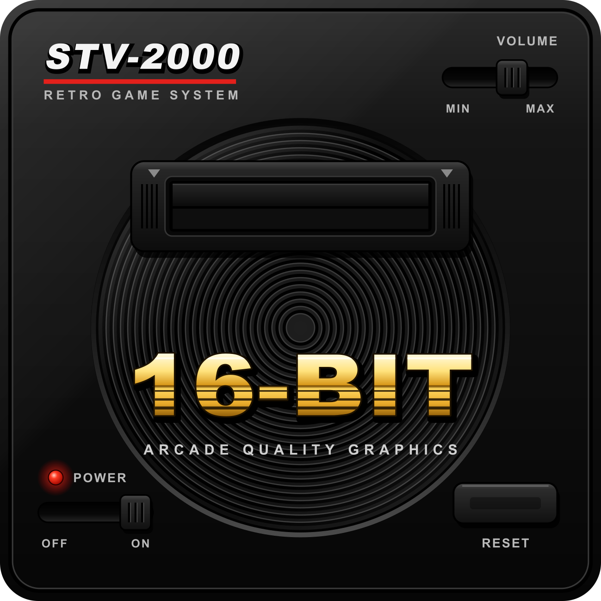

# Adesivo de console para a tampa

Arte de console 16-bit (preto, no estilo dos consoles do começo dos anos 90) para
imprimir e colar em cima do TV Box. A tampa do STV-2000 mede 11,5 × 11,5 cm; o
adesivo tem **11 × 11 cm**, com cantos arredondados, e sobra uma borda para prender com
plástico adesivo transparente.

<p align="center">
  
</p>

## Arquivos

| Arquivo | Para quê |
|---|---|
| [adesivo-console-16bit-A4-imprimir.pdf](adesivo-console-16bit-A4-imprimir.pdf) | **Imprimir em casa**: folha A4 com o adesivo, marcas de corte e uma régua de 10 cm |
| [adesivo-console-16bit-110mm.pdf](adesivo-console-16bit-110mm.pdf) | Só o adesivo em 110 × 110 mm (gráfica, papel adesivo) |
| [adesivo-console-16bit-110mm-300dpi.png](adesivo-console-16bit-110mm-300dpi.png) | Imagem de 1299 × 1299 px (300 dpi em 11 cm) |
| [adesivo-console-16bit-110mm.svg](adesivo-console-16bit-110mm.svg) | Vetor editável (Inkscape), em milímetros |

## Como imprimir

1. Abra o PDF A4 e imprima em **"Tamanho real" / escala 100%** (não use "Ajustar à
   página").
2. Meça a régua impressa: ela deve ter **10 cm**. Se não tiver, a impressão foi
   redimensionada.
3. Corte reto pelas marcas com estilete e régua e arredonde os cantos (raio ~7 mm).
4. Cole em cima do aparelho e cubra com plástico adesivo transparente, dobrando as
   sobras nas laterais.

Papel fotográfico ou adesivo brilhante deixa o preto parecido com o plástico de um
console. Se os sulcos do disco sumirem na impressão (impressoras escurecem tons de
cinza), clareie as linhas finas do grupo `disco` no SVG.

## Editar

O SVG está organizado em grupos (`corpo`, `disco`, `slot-cartucho`, `logo-16bit`,
`marca`, `controles`). Os textos são editáveis no Inkscape e usam as fontes *Arial
Black* e *Arial*. Sem elas instaladas, o SVG aparece com outra fonte; os PDFs não têm
esse problema, porque neles o texto já está convertido em curvas.

Para exportar de novo depois de editar:

```sh
inkscape adesivo-console-16bit-110mm.svg --export-type=pdf --export-text-to-path --export-filename=adesivo.pdf
```

A arte não usa logotipos nem marcas de fabricantes de videogame.
